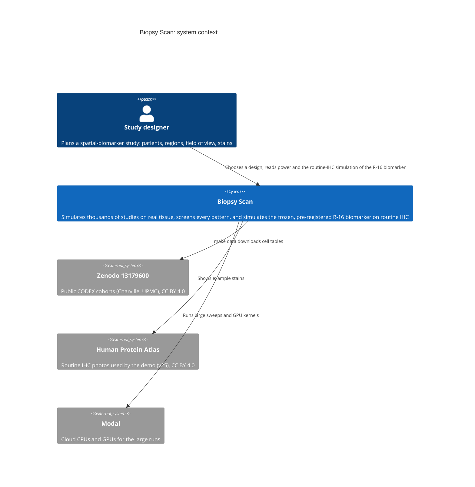
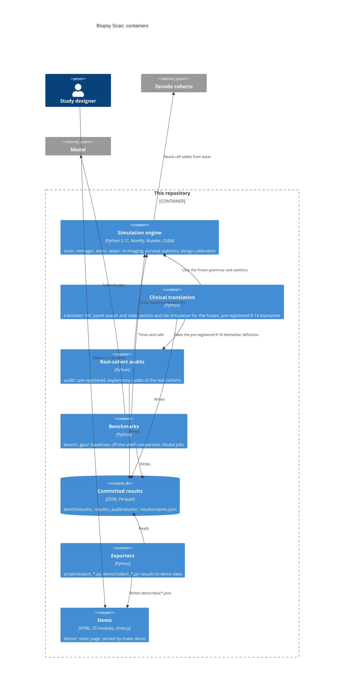
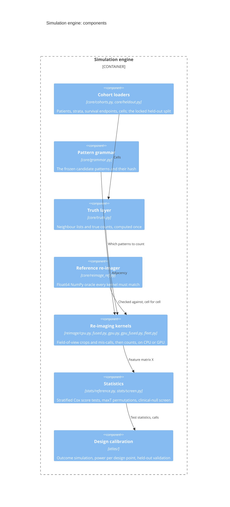

# Architecture

How Biopsy Scan fits together, from the outside in. The diagrams follow the
[C4 model](https://c4model.com/): system context, then containers, then the components of the
simulation engine. GitHub and the docs site render them from the Mermaid source below.

## 1. System context

Who uses Biopsy Scan, and what it depends on.

## 2. Containers

The runnable pieces and how data moves between them. Everything runs locally except the Modal jobs.

## 3. Components of the simulation engine

One simulated study: load a cohort, re-image every patient under the planned design, score every
candidate pattern, and decide with a calibrated multiple-testing threshold.

## Where to start reading

| If you want to… | Read |
|---|---|
| See what's frozen and why | [docs/CONTRACT.md](docs/CONTRACT.md), [docs/PREREGISTRATION.md](docs/PREREGISTRATION.md) |
| Follow one re-imaged region | `core/reimage_ref.py`, then `reimage/fused.py` |
| Follow the multiple-testing screen | `stats/screen.py` |
| Check a published number | [RESULTS.md](RESULTS.md) and `results/claims.json` (`python3 -I scripts/check_claims.py`) |
| Run on GPUs | [docs/GPU.md](docs/GPU.md), `gpu/modal_app.py` |

## Invariants

- **Every kernel matches the reference.** The CPU, fused and GPU kernels are tested against
  `core/reimage_ref.py` (bit-equal feature matrices, or within a stated tolerance).
- **The held-out split is locked before any search.** `core/heldout.py` writes the manifest and the
  loaders refuse to load locked patients for discovery.
- **Every published number has a source.** `results/claims.json` binds each headline number to the
  file it came from; the claims test fails on drift.
