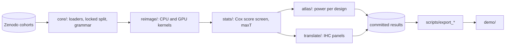

# Preflight

**Know whether your spatial-biology study can work before you image a single slide.**

[](LICENSE)
[](https://github.com/atiladeokegab/biopsy-scan/actions/workflows/smoke.yml)

[](https://biopsy-scan.readthedocs.io/)

Preflight simulates thousands of cell-by-cell spatial-biomarker studies on real CODEX tumour tissue.
For a planned study (number of patients, regions per patient, field of view, cell mis-call rate), it
tells you how likely the study is to find a survival-linked cell pattern. It screens every candidate
pattern with honest multiple-testing correction, and checks how much of the signal survives when the
study moves to one- or two-stain clinical IHC.


## Why

A spatial study is expensive to image, and textbook power formulas assume every cell is measured
perfectly. On real tissue they are far too optimistic:

| 200 patients, HR 2 per SD | Study power |
|---|---|
| Schoenfeld formula | 80.1% |
| Preflight, simulated on real tissue (300 studies) | **27.0%** (95% CI 22.1–32.4%) |

Source: [`bench/results/vs-schoenfeld-300.json`](bench/results/vs-schoenfeld-300.json).

## What it does

- **Re-images real tissue.** Takes cells from public CODEX cohorts and simulates new studies with your
  design: field of view, regions per patient, mis-called cells.
- **Screens every pattern fairly.** Stratified Cox score tests with Westfall–Young `maxT`
  permutations across thousands of candidate patterns, so a lucky hit isn't reported as a finding.
- **Translates to the clinic.** Searches one- and two-marker IHC panels and simulates single
  slides, serial sections and tiles.
- **Runs fast.** A fused Numba kernel on 8 CPU cores is **534× faster** than an off-the-shelf
  squidpy + lifelines pipeline on the same host, median of 3 runs
  ([details and caveats](RESULTS.md#speed-headline)). The demo's race replays measured throughput
  against the fused kernel on one H100 (10,800× per study, measured in separate runs).

| Start from real tissue | Race the off-the-shelf tools | Take it to routine IHC |
|---|---|---|
|  |  |  |

## Quick start

You need `git`, `make`, [`uv`](https://docs.astral.sh/uv/), a system `python3` (3.9 or later) and
Node.js. uv installs the pinned Python 3.11 for you.

```sh
git clone https://github.com/atiladeokegab/biopsy-scan.git
cd sota-parallelism-nov21
make smoke   # installs, runs the offline test suite and the demo checks (no data or GPU needed)
make demo    # serves the demo at http://localhost:8000 (PORT=8001 if busy)
```

A cold `make smoke` takes about 7 minutes.

**More:**
- `make race-local` reruns the speed race on your own CPU (Linux or macOS). It downloads the data
  the first time.
- `make data` downloads the public CODEX cohorts (about 730 MB) into `data/`, which git ignores.
  Set `DATA_DIR` to use another folder.

## Results

Every number carries an evidence label (**MEASURED**, **ESTIMATE**, **ANALYTIC**, **SYNTHETIC** or
**UNMEASURED**) and links the committed file it came from. Real-cohort results are exploratory: the
outcomes were already seen, so they make no clinical claim. Highlights:

- **Power at scale (Charville cohort):** 68.3% power at 400 patients; about 524 patients for 80%.
- **Head and neck (UPMC cohort):** about 234 patients for 80% power.
- **Joint screen of 3,780 patterns:** best `maxT` p = 0.098. No pattern beats chance, and Preflight
  says so instead of guessing.

The full table, with every caveat: **[RESULTS.md](RESULTS.md)**. Negative results:
[docs/negative-result.md](docs/negative-result.md).

## Architecture

Raw cell tables go through four stages: load and lock the held-out patients, re-image every
patient under the planned design, score every candidate pattern with calibrated multiple testing,
then translate the winner to a routine stain. Exporters turn committed results into the static demo.



The C4 diagrams (context, containers, engine components) are in [ARCHITECTURE.md](ARCHITECTURE.md).

## Repository layout

| Folder | What's in it |
|---|---|
| [`core/`](core/) | Cohort loaders, the discovery/locked split, the spatial pattern grammar, and the NumPy reference re-imager ([contract](docs/CONTRACT.md)) |
| [`reimage/`](reimage/) | Numba CPU and CUDA re-imaging kernels, and the multi-GPU shard coordinator |
| [`stats/`](stats/) | Stratified Cox score statistics, `maxT` and omnibus permutations, the clinical-null bootstrap screen |
| [`translate/`](translate/) | IHC panel search and single-slide, serial-section and tile simulation |
| [`audit/`](audit/) | Exploratory audits of the real cohorts and the pre-registered biomarker definition |
| [`bench/`](bench/) | Baselines, comparisons with off-the-shelf tools, and every committed result in `bench/results/` |
| [`gpu/`](gpu/) | Modal jobs for the large runs |
| [`demo/`](demo/) | The static demo (plain HTML and JS, no build step) |
| [`docs/`](docs/) | Design, [pre-registration](docs/PREREGISTRATION.md), [prior work](docs/PRIOR-WORK.md) and [results](RESULTS.md) |

## Data

The cohorts come from Wu et al., *Nature Biomedical Engineering* (2022), Zenodo record
[13179600](https://zenodo.org/records/13179600), under
[CC BY 4.0](https://creativecommons.org/licenses/by/4.0/). The data isn't in this repository:
`make data` downloads it.

The tissue photos in the demo and in the images above come from the
[Human Protein Atlas](https://www.proteinatlas.org/) (Uhlen et al.) under
[CC BY-SA 3.0](https://creativecommons.org/licenses/by-sa/3.0/), not MIT.

## Documentation

Full documentation, with the architecture, methods, pre-registration and every result, is at
**[biopsy-scan.readthedocs.io](https://biopsy-scan.readthedocs.io/)**. To build it locally:

```sh
uv run --no-project --with-requirements docs/requirements.txt mkdocs serve
```

## Contact

- **Questions** ("how do I…?", "what does this number mean?"): start a thread in
  [Discussions](https://github.com/atiladeokegab/biopsy-scan/discussions).
- **Bugs and feature requests:** open an [issue](https://github.com/atiladeokegab/biopsy-scan/issues).
- **Security issues:** report privately, see [SECURITY.md](SECURITY.md).
- **The authors:**

| | GitHub | LinkedIn |
|---|---|---|
| Atilade Oke | [@atiladeokegab](https://github.com/atiladeokegab) | [atiladeoke](https://www.linkedin.com/in/atiladeoke/) |
| Faisal Lawan | [@FHL-08](https://github.com/FHL-08) | [faisal-lawan](https://www.linkedin.com/in/faisal-lawan/) |

## Contributing

Issues and pull requests are welcome: see [CONTRIBUTING.md](CONTRIBUTING.md) and the
[Code of Conduct](CODE_OF_CONDUCT.md). Report security issues privately ([SECURITY.md](SECURITY.md)).

Planned upstream work: batched neighbourhood counts for
[squidpy](https://squidpy.readthedocs.io/), stratified score-test helpers for
[lifelines](https://lifelines.readthedocs.io/), and vectorised permutation concordance for
[scikit-survival](https://scikit-survival.readthedocs.io/).

## Citation

GitHub's "Cite this repository" button reads [CITATION.cff](CITATION.cff). Or use:

```bibtex
@software{preflight_2026,
  author  = {{Team Dry Lab}},
  title   = {Preflight: Cell-by-Cell Spatial-Biomarker Study Simulation and Clinical IHC Translation},
  year    = {2026},
  url     = {https://github.com/atiladeokegab/biopsy-scan},
  license = {MIT}
}
```

If you use the cohorts or the biomarker definitions, please also cite Wu et al., *Nature Biomedical
Engineering* (2022) and Punovuori et al., *Cell* 187:7267 (2024). The biology of the pre-registered
rule comes from Punovuori et al.

## License

[MIT](LICENSE) © 2026 Team Dry Lab: [Atilade](https://github.com/atiladeokegab) and
[Faisal](https://github.com/FHL-08).
