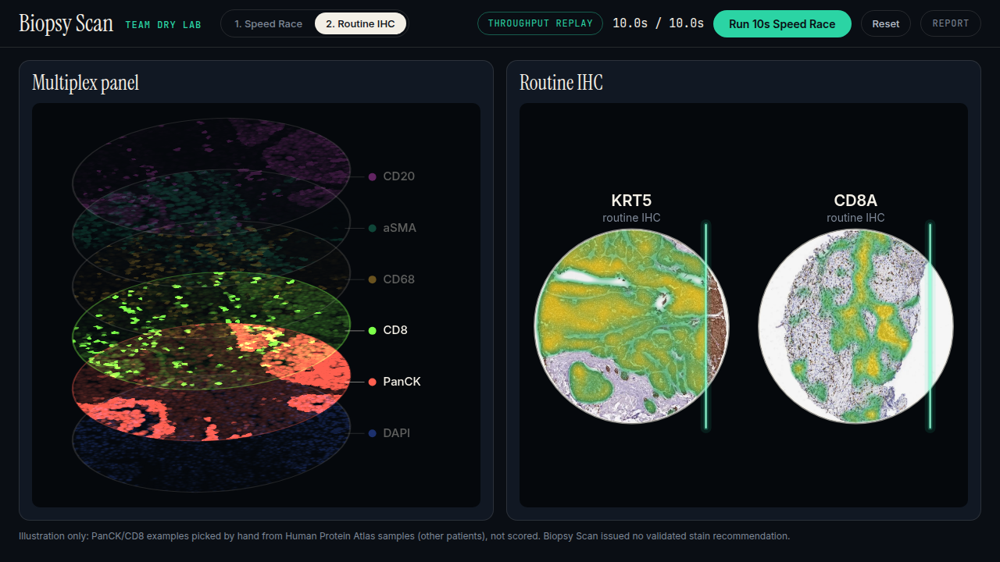
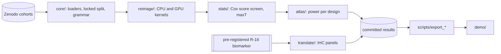

# Biopsy Scan

**Know whether your spatial-biology study can work before you image a single slide.**

[](LICENSE)
[](https://github.com/atiladeokegab/biopsy-scan/actions/workflows/smoke.yml)

[](https://atiladeokegab.github.io/biopsy-scan/)

Biopsy Scan simulates thousands of cell-by-cell spatial-biomarker studies on real CODEX tumour tissue.
For a planned study (number of patients, regions per patient, field of view, cell mis-call rate), it
tells you how likely the study is to find a survival-linked cell pattern. It screens every candidate
pattern with honest multiple-testing correction, and checks how much of the signal survives when the
study moves to one- or two-stain clinical IHC.


## Why

A spatial study is expensive to image, and textbook power formulas assume every cell pattern is
measured exactly on the whole tissue. In one modelled scenario on the Charville colorectal cohort,
the formula is far too optimistic:

| 200 simulated patients, HR 2.0 per SD, 630 candidate patterns, Bonferroni at α = 0.05 | Study power |
|---|---|
| Schoenfeld formula (**ANALYTIC**) | 80.1% |
| Biopsy Scan, cell-by-cell simulation on real tissue, 300 studies (**ESTIMATE**) | **27.0%** (95% CI 22.1–32.4%) |

The simulated design images 2 fields of view of 400 µm per patient and mis-calls 10% of cells.
The gap depends on the design: across the 7 patient counts tested, the formula overstated power at
6 and understated it at 1. Source:
[`bench/results/vs-schoenfeld-300.json`](bench/results/vs-schoenfeld-300.json).

## What it does

- **Re-images real tissue.** Takes cells from public CODEX cohorts and simulates new studies with your
  design: field of view, regions per patient, mis-called cells.
- **Screens every pattern fairly.** Stratified Cox score tests with Westfall–Young `maxT`
  permutations, which adjust for testing thousands of candidate patterns at once.
- **Translates to the clinic.** Searches one- and two-marker IHC panels and simulates single
  slides, serial sections and tiles.
- **Runs fast.** On the same host with 8 CPU workers per side, the fused Numba kernel is
  **534× faster** per study than an off-the-shelf squidpy + lifelines pipeline (median of 3 fresh
  containers, range 511–547×; 312× on the same 48 studies). The timing windows differ: the
  off-the-shelf time is the whole call per study, the fused time is re-imaging and scoring only
  ([details and caveats](RESULTS.md#speed-headline)).
- **The race in the demo** replays two measurements taken in separate runs: the same off-the-shelf
  pipeline (22.35 s per study, 8 CPU workers) against the fused kernel on one H100 (0.00207 s per
  evaluation, re-imaging and scoring), about 10,800× ([source](RESULTS.md#demo-race-replay)).

| Start from real tissue | Race the off-the-shelf tools | Take it to routine IHC |
|---|---|---|
|  |  |  |

## Quick start

You need `git`, `make`, [`uv`](https://docs.astral.sh/uv/), a system `python3` (3.9 or later) and
Node.js. uv installs the pinned Python 3.11 for you.

```sh
git clone https://github.com/atiladeokegab/biopsy-scan.git
cd biopsy-scan
make smoke   # installs, runs the offline test suite and the demo checks (no data or GPU needed)
make demo    # serves the demo at http://localhost:8000 (PORT=8001 if busy)
```

A cold `make smoke` takes about 7 minutes.

**More:**
- `make race-local` runs a smaller CPU benchmark on your own machine (Linux or macOS): the lab
  method (fresh cKDTree re-imaging and a 1,000-shuffle permutation test per study) against the
  fused Numba kernel, on a small Charville slice. It isn't the 534× comparison. It downloads the
  data the first time.
- `make data` downloads the public CODEX cohorts (about 730 MB) into `data/`, which git ignores.
  Set `DATA_DIR` to use another folder.

## Results

Every number carries an evidence label (**MEASURED**, **ESTIMATE**, **ANALYTIC**, **SYNTHETIC** or
**UNMEASURED**) and links the committed file it came from. Real-cohort results are exploratory: the
outcomes were already seen, so they make no clinical claim. Highlights:

- **Power at scale (Charville, simulated cohorts):** 68.3% power at 400 patients (95% CI
  62.7–73.6%); about 524 patients for 80%, interpolated between simulated sizes of 500 and 600.
- **Head and neck (UPMC):** about 234 patients for 80% power, on simulated cohorts resampled from
  the tissue of 34 discovery patients, with simulated outcomes.
- **Joint screen of 3,780 patterns (Charville, 159 patients):** best `maxT` p = 0.098, so no
  pattern reached corrected significance, and Biopsy Scan reports that instead of a finding. A
  corrected screen still allows false positives at its stated error rate.

The full table, with every caveat: **[RESULTS.md](RESULTS.md)**. Negative results:
[docs/negative-result.md](docs/negative-result.md).

## Architecture

Raw cell tables go through four stages: load and lock the held-out patients, re-image every
patient under the planned design, and score every candidate pattern with calibrated multiple
testing. Translation to a routine stain takes a separate input: the frozen, pre-registered R-16
biomarker, not the screen's top pick. Exporters turn committed results into the static demo.



The C4 diagrams (context, containers, engine components) are in [ARCHITECTURE.md](ARCHITECTURE.md).

## Repository layout

| Folder | What's in it |
|---|---|
| [`core/`](core/) | Cohort loaders, the discovery/locked split, the spatial pattern grammar, and the NumPy reference re-imager ([contract](docs/CONTRACT.md)) |
| [`reimage/`](reimage/) | Numba CPU and CUDA re-imaging kernels, and the multi-GPU shard coordinator |
| [`stats/`](stats/) | Stratified Cox score statistics, `maxT` and omnibus permutations, the clinical-null bootstrap screen |
| [`translate/`](translate/) | IHC panel search and single-slide, serial-section and tile simulation |
| [`audit/`](audit/) | Exploratory audits of the real cohorts and the pre-registered biomarker definition |
| [`bench/`](bench/) | Baselines, comparisons with off-the-shelf tools, and every committed result in `bench/results/` |
| [`gpu/`](gpu/) | Modal jobs for the large runs |
| [`demo/`](demo/) | The static demo (plain HTML and JS, no build step) |
| [`docs/`](docs/) | Design, [pre-registration](docs/PREREGISTRATION.md), [prior work](docs/PRIOR-WORK.md) and [results](RESULTS.md) |

## Data

The cohorts come from Wu et al., *Nature Biomedical Engineering* (2022), Zenodo record
[13179600](https://zenodo.org/records/13179600), under
[CC BY 4.0](https://creativecommons.org/licenses/by/4.0/). The full cell tables aren't in this
repository: `make data` downloads them. Some derived extracts are committed so the results and the
demo can be checked without the download, and are redistributed under the same CC BY 4.0 licence
with the attribution above:

- **Cell-level extracts** (cell positions and types from Charville patients): `demo/app/cells.json`,
  `demo/data/tissue.json` and `demo/data/tma.json`.
- **Patient-level values:** some committed result files carry the cohorts' coded patient labels and
  follow-up times, as published in the Zenodo record.
- **Aggregates:** the per-design results under `atlas/results/` and the benchmark outputs under
  `bench/results/` hold summary statistics, not cells.

The six routine IHC photos in the demo, and in the closing frames of the race GIF and the Routine IHC screenshot
above, come from the
[Human Protein Atlas](https://v25.proteinatlas.org/) version 25, under
[CC BY 4.0](https://creativecommons.org/licenses/by/4.0/). They are cropped to the tissue core,
resized and, in the demo, shown with coloured overlays. Each image's source page is listed in
[`demo/workflow/img/hpa_manifest.json`](demo/workflow/img/hpa_manifest.json). Reference: Uhlén M
et al., Tissue-based map of the human proteome, *Science* 347, 1260419 (2015).

## Documentation

Full documentation, with the architecture, methods, pre-registration and every result, is at
**[atiladeokegab.github.io/biopsy-scan](https://atiladeokegab.github.io/biopsy-scan/)**. To build it locally:

```sh
uv run --no-project --with-requirements docs/requirements.txt mkdocs serve
```

## Contact

- **Questions** ("how do I…?", "what does this number mean?"): start a thread in
  [Discussions](https://github.com/atiladeokegab/biopsy-scan/discussions).
- **Bugs and feature requests:** open an [issue](https://github.com/atiladeokegab/biopsy-scan/issues).
- **Security issues:** report privately, see [SECURITY.md](SECURITY.md).
- **The authors:**

| | GitHub | LinkedIn |
|---|---|---|
| Atilade Oke | [@atiladeokegab](https://github.com/atiladeokegab) | [atiladeoke](https://www.linkedin.com/in/atiladeoke/) |
| Faisal Lawan | [@FHL-08](https://github.com/FHL-08) | [faisal-lawan](https://www.linkedin.com/in/faisal-lawan/) |

## Contributing

Issues and pull requests are welcome: see [CONTRIBUTING.md](CONTRIBUTING.md) and the
[Code of Conduct](CODE_OF_CONDUCT.md). Report security issues privately ([SECURITY.md](SECURITY.md)).

Planned upstream work: batched neighbourhood counts for
[squidpy](https://squidpy.readthedocs.io/), stratified score-test helpers for
[lifelines](https://lifelines.readthedocs.io/), and vectorised permutation concordance for
[scikit-survival](https://scikit-survival.readthedocs.io/).

## Citation

GitHub's "Cite this repository" button reads [CITATION.cff](CITATION.cff). Or use:

```bibtex
@software{preflight_2026,
  author  = {{Team Dry Lab}},
  title   = {Biopsy Scan: Cell-by-Cell Spatial-Biomarker Study Simulation and Clinical IHC Translation},
  year    = {2026},
  url     = {https://github.com/atiladeokegab/biopsy-scan},
  license = {MIT}
}
```

If you use the cohorts or the biomarker definitions, please also cite Wu et al., *Nature Biomedical
Engineering* (2022) and Punovuori et al., *Cell* 187:7267 (2024). The biology of the pre-registered
rule comes from Punovuori et al.

## License

The software is released under the MIT licence. The data and images keep their own licences (see [Data](#data)).

[MIT](LICENSE) © 2026 Team Dry Lab: [Atilade](https://github.com/atiladeokegab) and
[Faisal](https://github.com/FHL-08).
