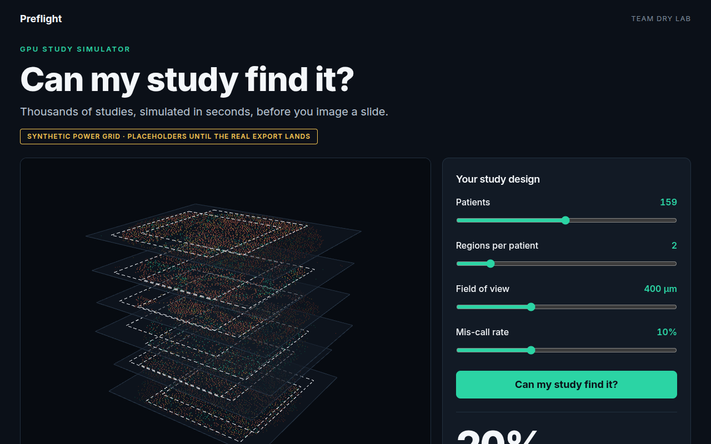

# Preflight

**Preflight simulates thousands of cell-by-cell spatial-biomarker studies on real CODEX tissue before you image a slide, screens every candidate pattern with honest multiple-testing correction, and tests how much signal survives one- or two-stain clinical IHC.**

[](LICENSE)
Live interactive demo: <https://atiladeokegab.github.io/sota-parallelism-nov21/>  
A recorded walkthrough accompanies the submission.



Every number below carries its evidence label — **MEASURED**, **ESTIMATE**, **ANALYTIC**, **SYNTHETIC**, or **UNMEASURED** — and links its committed source file. Real-cohort results are exploratory (*outcomes already seen; no clinical survival claims*).

## Committed Results (on `integration`)

| Finding | Result & Label | Source |
|---|---|---|
| **Textbook vs simulated study power** (`n = 200`, `HR = 2.0/SD`, `M = 630`, `alpha = 0.05`) | Schoenfeld formula predicts `80.1%` (**ANALYTIC**); cell-by-cell real-tissue simulation gives `27.0%`, 95% CI `[22.1%, 32.4%]` over `300` studies (**ESTIMATE**) | [`bench/results/vs-schoenfeld-300.json`](bench/results/vs-schoenfeld-300.json) |
| **Power at scale** (Charville, `HR = 2.0/SD`, #83/#104) | `68.3%` `[62.7, 73.6]` at `400` patients; about `524` patients for `80%`, interpolated between `500` and `600` (**ESTIMATE** (SIMULATED)) | [`bench/results/power-at-scale.json`](bench/results/power-at-scale.json) |
| **Charville joint screen (v2)** (`159` patients, `38` events, `3,780` patterns: v1's `630` plus `3,150` on the same patients, `10` channels) | maxT p = 0.098 over 3,780 patterns (top `Tumor 5\|Macrophage\|100um\|PD1`, `z = 3.96`, `9,999` resamples; omnibus p = `0.1688`; NumPy ref `2,149.61 s`) (**MEASURED**, exploratory) | [`results/charville-v2.json`](results/charville-v2.json) (#47) |
| **UPMC cohort counts** (verified case identity, descriptive only) | Current discovery default: **`34` patients, `125` regions, `6` events** (`97` regions locked in [`core/upmc_locked.json`](core/upmc_locked.json), **MEASURED**, [`docs/CONTRACT.md`](docs/CONTRACT.md)). Historical pre-lock full source: `50` patients, `188` regions, `10` events, `612` features; tuple sensitivity `79–81` patients, `27` events (**MEASURED**, pre-lock historical & descriptive only) | [`docs/CONTRACT.md`](docs/CONTRACT.md), [`audit/results/upmc.json`](audit/results/upmc.json) |
| **UPMC R-16 locked rediscovery** (pre-registered rule, #61; `16` locked patients, `4` events) | Locked feature `Tumor (Podo+)\|Stromal / Fibroblast\|25um\|fraction`: HR per SD `1.82` `[0.47, 6.97]`, one-sided p `0.193`, C-index `0.548`; the locked test does not pass. **UNMEASURED** (underpowered: conditional power `18%` < `50%` with `4` design events), so these numbers are inconclusive. Discovery rank `366` of `612` (**MEASURED**, discovery patients only). The Charville top hit is not testable on UPMC (PD1 absent). Exploratory: outcomes already published (Wu et al., *Nat Biomed Eng* 2022; rule biology from Punovuori et al., *Cell* 2024); internal held-out split | [`results/upmc-rediscovery.json`](results/upmc-rediscovery.json) (#109) |
| **UPMC R-17 Translate** | Translate run pending (**UNMEASURED**) | [`results/upmc-translate.json`](results/upmc-translate.json) |
| **R-15 clinical-null calibration** (`1,000` datasets, `n = 120`, `20` correlated candidates, `B = 99`) | Clinical-null parametric bootstrap FWER `0.060` (`60/1,000`, `[0.046, 0.077]` CP 95%) vs `0.997` (`997/1,000`) unadjusted (**SYNTHETIC**) | [`stats/results/hard-negative-f458ad1.json`](stats/results/hard-negative-f458ad1.json) |
| **R-15 vs R-14 workflow comparator** (`3,780` Charville v2 patterns, `8` cores) | R-15 score screen (`numpy`, `n_perm=0`) median `0.803 s` vs `63.84 s` full-dataset (`4.67x` vs 1 worker, [`impl-a`](bench/results/impl-a-charville-amd-epyc-7b13.json)) / `32.36 s` paired median `PHReg` (**MEASURED**, workflow ratio `40.3x`, different statistics) | [`bench/results/screen-vs-r14.json`](bench/results/screen-vs-r14.json), [`bench/results/impl-a-charville-amd-epyc-7b13.json`](bench/results/impl-a-charville-amd-epyc-7b13.json) |
| **Lab today baseline** (`rung 0`, 1-core `cKDTree` + `1,000` permutations) | `7.52 s/study` mean of `3` Charville studies (**MEASURED**); `7,521 s` extrapolated for `1,000` studies (**ESTIMATE**) | [`bench/results/cpu-ladder.json`](bench/results/cpu-ladder.json) |
| **CPU re-imaging ladder** (`100` studies, `159` patients, `619,645` cells, load `10–26`) | NumPy ref `2.98 s/study` vs active-wait 8-thread Numba `3.26 s/study` (**MEASURED**) | [`bench/results/cpu-ladder.json`](bench/results/cpu-ladder.json) |
| **Numba vs NumPy, quiet host** (`8` Modal cores, `5 rounds × 2 studies` per mode, #94) | Numba `2.5–4.1×` faster than NumPy per study, by threading mode (**MEASURED**) | [`bench/results/modal-quiet-cpu-20261121T180327Z.json`](bench/results/modal-quiet-cpu-20261121T180327Z.json) |
| **OpenMP spin diagnostic & quiet 8-core rerun** (`2` studies/condition vs `5 rounds × 2 studies`) | At load `~60` (`59.96–61.11`, `2` studies), `OMP_WAIT_POLICY=PASSIVE` fixes active spin (`2.48 s` vs `8.72 s` NumPy/study, ratio `0.28`, **MEASURED**); on `8` quiet Modal cores (`load 0.0`, `5 rounds × 2 studies`), `numba-8-omp` runs `0.70–0.81 s` vs `2.87–4.74 s` NumPy (**MEASURED**) | [`bench/results/numba-negative.json`](bench/results/numba-negative.json), [`bench/results/modal-quiet-cpu-20261121T180327Z.json`](bench/results/modal-quiet-cpu-20261121T180327Z.json) |
| **GPU fleet** (`1,000` Charville studies, `8` vs `1` A100 GPUs, #75) | MEASURED, observed 6.6× compute-span reduction 843.7→128.2 s for 1,000 Charville re-imaging/feature-generation studies, 8 A100-SXM4-40GB vs 1, one sweep; outputs bit-identical; inference outside timing | [`bench/results/modal-a100-20261121T183709Z.json`](bench/results/modal-a100-20261121T183709Z.json) |
| **GPU kernel** (one study, `5` seeds, feature step only) | `3.19×` (median): NumPy `2.24 s` vs GPU `0.70 s`, exact parity (**MEASURED**) | [`bench/results/modal-a100-20261121T183709Z.json`](bench/results/modal-a100-20261121T183709Z.json) |
| **Design-point race** (Charville, one A100 + 8-core container class, `1,000` studies per stream, one sweep, #113) | In-container study and scoring wall time per evaluated study (excludes load, prep, adjacency, warm-up, cutoff and rate summary): lab `0.881 s` vs Preflight on 8 CPU cores (Numba) `0.125 s`, `7.0×` per evaluated study; Preflight's `3,000` studies include its `1,000` calibration nulls, the lab's `2,000` have none. Totals for the same design-point output: lab `1,761.88 s` vs Preflight `375.26 s`, `4.70×`. Different procedures: per-study permutation vs one calibrated threshold. Hybrid (CPU re-imaging feeding A100 scoring) `0.126 s` per study, a tie with Numba: re-imaging is `99.6%` and `98.0%` of their time. Numba vs A100 z agree to `2.3e-15` relative; hybrid checked through each study's maxT (**MEASURED**) | [`bench/results/modal-design-20261121T194458Z.json`](bench/results/modal-design-20261121T194458Z.json) |
| **Fused re-imaging kernel** (Charville, same container class and design point as the race, #120) | Compute wall per evaluated study (re-imaging and scoring; excludes load, prep, adjacency and warm-up): lab `0.881 s` (`2,000` studies) vs fused Numba `0.0419 s` (`3,000` studies, its `1,000` calibration nulls included), `21.0×`. `8` single-thread workers in each arm. Same features in every arm (X sha256 bit-equal against the race's lab, Numba, A100 and hybrid arms); same top score (maxT equal to the Numba arm's). The procedures differ as in the race (**MEASURED**). Three fresh-container repeats each (#126): `25.2×` ratio of median walls, range `25.0–29.9×` from the extreme pairs, `200` lab vs `3,000` fused studies per repeat; descriptive, not an interval around `21.0×` | [`bench/results/modal-design-20261121T205536Z.json`](bench/results/modal-design-20261121T205536Z.json), [`bench/results/repeats-20261121T2209Z.json`](bench/results/repeats-20261121T2209Z.json) |
| **CPU strong scaling** (Numba arm, Charville, the same `1,000` null studies at `1–64` Modal cores, one concurrent sweep, #115) | One sweep. Studies wall per study `1.151 s` on 1 core vs `0.0301 s` on 64 cores: `38.2×`. The 4- and 8-core points beat linear (`5.07×`, `12.71×`); one sweep, not separated from host variance (each core count on its own host, CPU models unknown, RAM grows with cores; host, cache and scheduling effects not isolated): observed ratios, not a guaranteed speed-up. X sha256 bit-equal at every core count; z within `1e-9` relative of the 8-core z (**MEASURED**) | [`bench/results/modal-scaling-20261121T201008Z.json`](bench/results/modal-scaling-20261121T201008Z.json) ([caveats](bench/results/modal-scaling-20261121T201008Z.caveats.json)) |
| **Matched end to end** (lab vs Preflight, same container, design and seeds, #123) | Matched workflow comparison through scoring (re-imaging plus each study's test or screen; excludes data load, threshold and calls): lab `8.818 s` per study (`100` studies) vs Preflight `0.2096 s` per decided study (`2,000` decided, its `1,000` calibration nulls paid for): `42.1×`; `26.7×` including setup (outcome simulation, adjacency, warm-up). `1` lab core vs `8` Preflight workers; different procedures (per-study permutation vs one calibrated threshold). Features bitwise on `100` shared studies; decisions agree `89/100` (**MEASURED**, outcomes SYNTHETIC) | [`bench/results/matched-e2e-20261121T201925Z.json`](bench/results/matched-e2e-20261121T201925Z.json) |
| **Power gap, same design point** (`1,000` alternative studies each, #113) | Power `15.3%` (`153/1,000`) with Preflight's one calibrated threshold vs `20.3%` (`203/1,000`) with the lab's per-study permutation: different procedures, so a method difference, not a speed artefact (rates **ESTIMATE**, compute **MEASURED**) | [`bench/results/modal-design-20261121T194458Z.json`](bench/results/modal-design-20261121T194458Z.json) |
| **Event-count calibration** (two event-count bins vs one pooled threshold, same `1,000` alternative studies, #117) | Power `15.5%` two-bin vs `15.3%` pooled: paired gain `+0.2` pp `[-0.7, +1.1]` (paired bootstrap 95%), no clear recovery of the power gap (**ESTIMATE**) | [`bench/results/event-count-calibration.json`](bench/results/event-count-calibration.json) |
| **Interactive demo data** (`demo/`) | `12` Charville CODEX patients subsampled (`24,033` cells, **MEASURED**, [`demo/data/tissue.json`](demo/data/tissue.json)); Atlas power grid (`48` design points, `1,000` studies each: compute **MEASURED**, simulated power **ESTIMATE**, outcomes **SYNTHETIC**, [`demo/data/grid.json`](demo/data/grid.json)) | [`demo/`](demo/) |

## Reproduce in 3 Commands

Requires [`uv`](https://docs.astral.sh/uv/) (installs pinned Python `3.11.*` automatically from `uv.lock`; cold `uv sync --dev` uses ~`1.5 GB` disk across cache + `.venv`) and Node.js (for `demo/race.test.mjs`):

```sh
git clone https://github.com/atiladeokegab/sota-parallelism-nov21.git && cd sota-parallelism-nov21
make smoke   # uv sync --dev, offline pytest suite, and node demo/race.test.mjs (no raw data, GPU, or env vars needed)
make demo    # validates demo/data and serves the interactive demo at http://localhost:8000 (PORT=8001 if busy)
```

Real cohort runs additionally fetch the public CODEX datasets into gitignored `data/` (`make data`, Zenodo [`13179600`](https://zenodo.org/records/13179600), [CC-BY-4.0](https://creativecommons.org/licenses/by/4.0/); optional `DATA_DIR` overrides `data/`).

## Repository Layout

- [`core/`](core/): Cohort loaders, UPMC discovery/locked split enforcement, frozen v1/v2 spatial grammar, and NumPy reference re-imager ([`docs/CONTRACT.md`](docs/CONTRACT.md)).
- [`reimage/`](reimage/): Numba CPU and CUDA cell-re-imaging kernels plus multi-GPU shard coordinator.
- [`stats/`](stats/): Stratified Cox score statistics, Westfall–Young `maxT`/omnibus permutations, and R-15 clinical-null parametric bootstrap screen ([`stats/screen.py`](stats/screen.py)).
- [`audit/`](audit/): Real-cohort exploratory audits (`audit/results/`) and pre-registered R-16 biomarker definition.
- [`translate/`](translate/): Nested-CV 1-/2-marker panel search (`A-17.1`) and single-slide / serial-section (`0–100 um`) / tile (`100–200 um`) IHC simulation (`A-17.2`).
- [`bench/`](bench/): Rung-0 baseline, `PHReg` workflow comparator (`impl_a`), Schoenfeld vs simulated power, CPU/OpenMP diagnostics, and committed results (`bench/results/`).
- [`demo/`](demo/): Static three.js showcase (`make deploy` / GitHub Pages). Specifications live in [`docs/PRD.md`](docs/PRD.md).

## MIT Licence & How to Cite

- **Licence:** Code and documentation in this repository are released under the **[MIT License](LICENSE)** (`Copyright (c) 2026 Team Dry Lab`, Team: [Atilade](https://github.com/atiladeokegab) & [Faisal](https://github.com/FHL-08)). Cohort data is sourced from Zenodo record [`13179600`](https://zenodo.org/records/13179600) under [CC-BY-4.0](https://creativecommons.org/licenses/by/4.0/).
- **How to cite:**

```bibtex
@software{preflight_2026,
  author       = {{Team Dry Lab}},
  title        = {Preflight: Cell-by-Cell Spatial-Biomarker Study Simulation and Clinical IHC Translation},
  year         = {2026},
  url          = {https://github.com/atiladeokegab/sota-parallelism-nov21},
  license      = {MIT}
}
```

If using the underlying cohorts or biomarker definitions, please also cite Wu et al., *Nature Biomedical Engineering* (2022; Zenodo [`13179600`](https://zenodo.org/records/13179600)) and Punovuori et al., *Cell* 187:7267 (2024).

Citation correction (2026-11-22): UPMC data = Wu et al., *Nature Biomedical Engineering* 2022 (Zenodo `13179600`, CC BY 4.0). Punovuori et al., *Cell* 2024 is where the R-16 rule's biology comes from, not the UPMC data source. The labels in the committed `results/upmc-*.json` files predate this correction; they are records of the one opening and are kept as written.

## Next: Contributing Back

**Next — contributing back *(planned, not done)*:** upstream pull requests to [`squidpy`](https://squidpy.readthedocs.io/) (batched/CSR radius-prefix neighbourhood counts), [`lifelines`](https://lifelines.readthedocs.io/) (`pandas` 3 / Python 3.11+ compatibility and stratified score-test helpers), and [`scikit-survival`](https://scikit-survival.readthedocs.io/) (vectorized permutation/bootstrap concordance and Cox score utilities).
