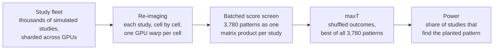

# Preflight

**Find the tissue patterns that decide a cancer patient's treatment, prove they are not luck, and check they still work as a test a hospital can run.**

Decode searches every spatial pattern in multiplex tissue (3,780 today) with an honest correction for multiple testing. Translate asks whether a pattern survives one or two routine stains and real-world imaging error, by re-imaging thousands of simulated studies cell by cell from real tissue (CODEX). That simulation is what runs on the GPU.

| Judging criterion | Result | Label | Source |
|---|---|---|---|
| **Correctness** | The Numba kernel equals the NumPy reference cell for cell, including where NaNs fall, on 100 real Charville studies. The CUDA kernel matches it too | MEASURED (CPU); TESTED (CUDA simulator) | `bench/results/cpu-ladder.json`, `reimage/test_backends.py` |
| | The score statistic equals statsmodels PHReg (Breslow ties), and its variance equals exhaustive permutations | TESTED | `stats/test_reference.py`, `tests/test_score_contract.py` |
| | 39 of 39 GPU tests pass on a real NVIDIA A100-SXM4-40GB: kernels, expression channels and the fleet | MEASURED | `bench/results/modal-a100-20261121T173127Z.json` (PR #75, in review) |
| | When nothing is there, the search raises a false alarm in 28 of 700 null studies: 4.0% (95% CI 2.7–5.7%), inside the promised 5% | ESTIMATE | `bench/results/vs-schoenfeld-300.json` |
| **Reshaping for parallelism** | Every study is independent: the kernel re-images a batch of studies with one GPU warp per cell, and the fleet shards studies across GPUs with results bit-identical to one device | TESTED (CUDA simulator); MEASURED bit-identical on 4 A100s | `reimage/test_backends.py`, `reimage/test_fleet.py`, `bench/results/modal-a100-20261121T171213Z.json` (PR #75) |
| | Testing all 3,780 patterns is one matrix product per study, U = X'r. One screen with 10,000 shuffles is about 38 million tests | TESTED (CPU) | `stats/test_reference.py` |
| **Speed vs the statsmodels baseline** | Baseline: one statsmodels PHReg Cox fit for each of the 3,780 Charville patterns takes 63.84 s on 8 workers and 298.30 s on 1 | MEASURED | `bench/results/impl-a-charville-amd-epyc-7b13.json` (#64) |
| | Re-imaging on one A100: 0.873 s per study against 2.880 s for the NumPy reference in the same container, ×3.3, with identical output | MEASURED | `bench/results/modal-a100-20261121T171213Z.json` (PR #75) |
| | Fleet: 16 studies on 4 A100 containers (one an 80 GB card) take 3.80 s against 11.44 s on 1, ×3.0 (75% scaling efficiency), bit-identical. Start-up, data load and the one-time neighbour search are excluded | MEASURED | `bench/results/modal-a100-20261121T171213Z.json` (PR #75) |
| | The GPU score screen on the 3,780 patterns (a workflow comparison, since the baseline fits full models), and the fleet at 8 and 16 GPUs | PENDING | Modal runs on A100s |
| **Scientific value** | At 200 patients the textbook formula promises 80% power. Simulated on real tissue, the same design finds the pattern 27% of the time (95% CI 22–32%) | ANALYTIC vs ESTIMATE | `bench/results/vs-schoenfeld-300.json` |
| | After 3,780 tests on Charville, the strongest pattern (PD1 on macrophages within 100 µm of "Tumor 5" cells, z = 3.96) is not significant: maxT-adjusted p = 0.098 | MEASURED | `results/charville-v2.json` |
| | Numba on 8 threads was no faster than NumPy on a loaded shared VM: 3.26 vs 2.98 s per study | MEASURED | `bench/results/cpu-ladder.json` |

**Live demo:** https://atiladeokegab.github.io/sota-parallelism-nov21/ · **Deck:** https://claude.ai/artifact/HsYFYZZygbAzNALjz2bm5Q


Every number carries one label. **MEASURED**: a committed results file from a real run. **TESTED**: a passing test in `make smoke`. **ESTIMATE**: a simulation or arithmetic on measured rows, with its interval. **ANALYTIC**: a formula. **REPORTED**: from a published paper. **PENDING**: not yet run. All real-data results are exploratory: the outcomes had already been seen.

## Why it matters

About half of patients with locally advanced head and neck cancer relapse ([PMC7902285](https://pmc.ncbi.nlm.nih.gov/articles/PMC7902285/)). The Helsinki study behind MultivisionDx (Punovuori et al., *Cell* 2024; [code](https://github.com/WickstromLab/Punovuori-et-al.-Cell-2024)) found that the arrangement of cells predicts who does well. Partial-EMT tumour cells in immune-rich stroma meant about 90% five-year survival; the same cells among fibroblasts meant about 21% (REPORTED). Stage cannot see that.

Finding such a pattern takes enough patients, and a lab sizes its study before it images a slide. The textbook formula ignores how a study samples tissue and mis-calls cells. Preflight simulates the study instead: thousands of times, cell by cell, from real tissue. That simulation is the GPU workload.

## How it works



1. **Draw the studies.** A design is a number of patients, regions per patient, a field of view and a mis-call rate. Preflight draws thousands of studies at that design from real CODEX tissue, and plants a known effect. Studies are independent, so the fleet shards them across GPUs by seed (`reimage/fleet.py`).
2. **Re-image each study cell by cell.** Each region's neighbour list is found once, by a CPU cKDTree at the largest radius, and sorted by distance, so 25, 50 and 100 µm are running totals of one list. Crops hide cells and mis-calls relabel them; the kernel recounts every cell's neighbours (`reimage/cpu.py`, `reimage/gpu.py`).
3. **Make every pattern a column.** A pattern is a cell type, a neighbour type, a radius and a measure: 630 neighbourhood patterns, plus 3,150 that add protein, size and stroma channels. Each study becomes a patients-by-3,780 matrix X (`core/grammar.py`).
4. **Screen all patterns at once.** Fit the survival null once and keep its residuals r. Every pattern's score is then one matrix product, U = X'r, batched across studies (`stats/reference.py`; the GPU screen is R-15).
5. **Correct honestly with maxT.** Shuffle outcomes within strata and ask how often the best of all 3,780 shuffled patterns beats the real one (Westfall–Young maxT). A study "finds" the effect only if the planted pattern survives that correction. Power is the share of studies that do.

Speed-ups are quoted only at equal output. Re-imaging is compared with what a lab runs today: per study, a fresh cKDTree recount and 1,000 permutations on one core, 7.52 s per study (MEASURED, `cpu-ladder.json` `lab_today`). The statsmodels baseline above fits a full Cox model per pattern, so a GPU score screen against it is a workflow comparison, not an equal-work speed-up.

## Reproduce it

Python 3.11 with [uv](https://docs.astral.sh/uv/), and Node for the demo's race test.

```sh
gh repo clone atiladeokegab/sota-parallelism-nov21 && cd sota-parallelism-nov21
make smoke    # the unit tests and the demo race test; offline, no real data, no GPU
make demo     # checks the demo's data, then serves it at http://localhost:8000
```

For real-data runs, `make data` fetches the Zenodo cohorts into `data/` and `make summary` prints patients, regions, events and the frozen grammar.

## Where the code lives

| Path | What |
|---|---|
| `core/` | Cohort loaders, patient identity, the frozen pattern grammar, the NumPy reference re-imager |
| `reimage/` | Numba CPU and CUDA kernels, and the fleet |
| `stats/` | Float64 score statistics, maxT and omnibus |
| `audit/`, `results/` | The real-data audit and its results |
| `bench/` | Rung 0, the statsmodels baseline, the ladder and the textbook comparison |
| `demo/` | The demo page (static HTML, JS and three.js; works offline) |

Requirements: [docs/PRD.md](docs/PRD.md) (v4).

## What is next, and the limits

- **The GPU numbers cover re-imaging only.** The kernel and a 4-container fleet of 16 studies are MEASURED; the GPU score screen and larger fleets are PENDING. The fleet times exclude set-up: each container first builds its neighbour lists on CPU (about 60 s), so at 16 studies the wall clock is 76.6 s on 4 containers against 164.6 s on 1 (MEASURED, same file).
- **The GPU screen (R-15)** with clinical covariates and a refit bootstrap null is in build, as are the rediscovery of the Helsinki pattern on locked UPMC patients (R-16), minimal panels and stain-format simulation (R-17), and the Charville rerun (R-18). Issues #66 to #71.
- **Real data is exploratory.** Both cohorts' outcomes were seen before the event. UPMC cannot carry a survival claim: 80 patients and 27 deaths, 23 and 8 locked (MEASURED, PR #62).
- **The demo's power chart is SYNTHETIC** until the design atlas (#45) replaces `demo/data/grid.json`. Its tissue is real Charville cells.
- **Timings ran on a shared, loaded VM** (load average up to 60), so CPU numbers understate a quiet machine.
- **Not in this build:** learned features, the brightfield scoring engine, markers from H&E, HANCOCK validation, and the image half (registration, segmentation, quantification).

## Data credits and team

The CODEX cohorts come from Zenodo record [13179600](https://zenodo.org/records/13179600), licensed [CC-BY-4.0](https://creativecommons.org/licenses/by/4.0/). Please cite Wu et al., *Nature Biomedical Engineering*, 2022. **UPMC**: head and neck cancer. **Charville**: Stanford colorectal cancer, the source of the demo's tissue. `make data` downloads them; they are not committed.

Team Dry Lab, SoTA Scientific Parallelism Hackathon 2026: [Atilade](https://github.com/atiladeokegab) and [Faisal](https://github.com/FHL-08).
