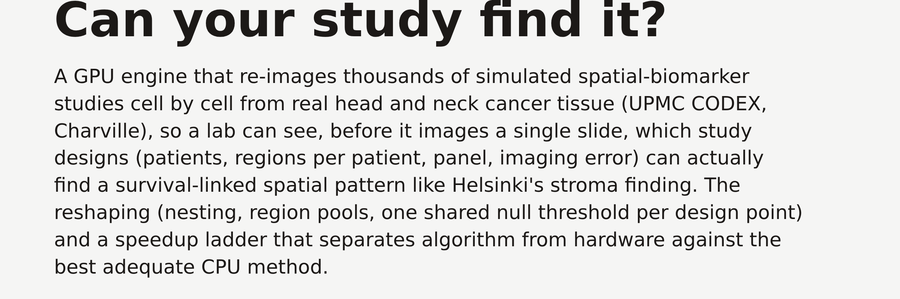

# Preflight

Thousands of studies, simulated in seconds, before you image a slide. Preflight re-images thousands of simulated spatial-biology studies cell by cell from real head and neck and colorectal cancer tissue on a GPU, so a lab sees in seconds which designs (patients, regions per patient, field of view, mis-call rate) can actually detect a survival-linked spatial pattern. Team Dry Lab, SoTA Scientific Parallelism Hackathon 2026.

## What it does

A GPU engine that re-images thousands of simulated spatial-biomarker studies cell by cell from real cancer tissue (head and neck and colorectal: UPMC CODEX, Charville), so a lab can see, before it images a single slide, which study designs (patients, regions per patient, panel, imaging error) can actually find a survival-linked spatial pattern like Helsinki's stroma finding. The reshaping (nesting, region pools, one shared null threshold per design point) and a speedup ladder that separates algorithm from hardware against the best adequate CPU method.

## Demo

The working demo will be added during the build.

## Screenshots

Screenshots will be added after the first working demo.

## Architecture

See [the product plan](IDEA.md) for the architecture.

## Run locally

```sh
gh repo clone atiladeokegab/sota-parallelism-nov21
cd sota-parallelism-nov21
make dev
```

## Team

- [Atilade](https://github.com/atiladeokegab)
- [Faisal](https://github.com/FHL-08)
