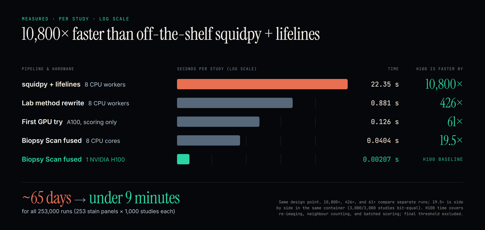
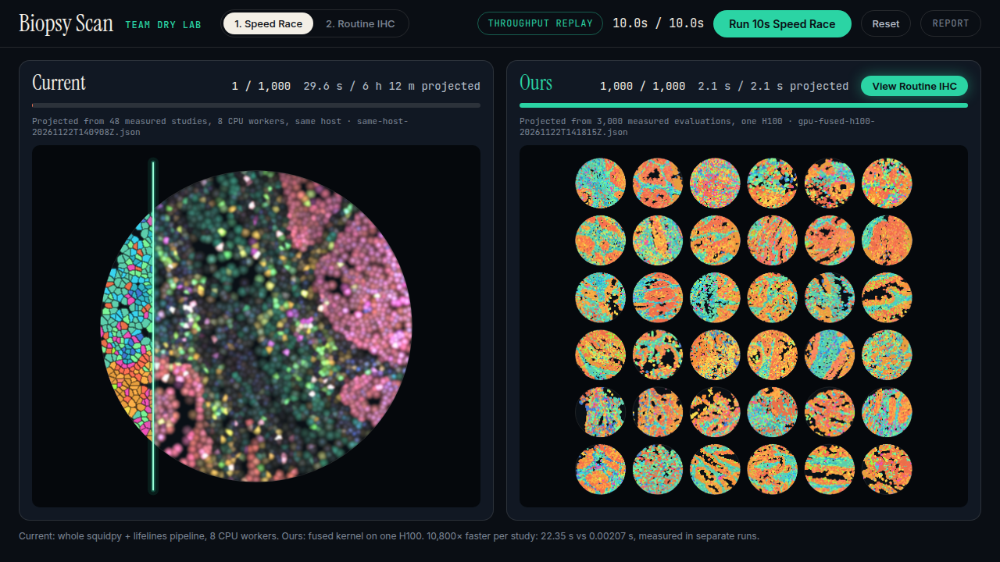

# Biopsy Scan

[](LICENSE)
[](https://github.com/atiladeokegab/biopsy-scan/actions/workflows/smoke.yml)

[](https://atiladeokegab.github.io/biopsy-scan/)

Biopsy Scan is an open-source GPU engine for spatial biomarker discovery and clinical stain translation in cancer biopsies. Research labs can image a tumour biopsy with 22 protein stains across hundreds of thousands of cells, while routine hospital pathology labs run only 1 or 2 stains. Screening thousands of spatial cell patterns against patient survival, ruling out false positives with permutation shuffles, and testing which 1 or 2 routine stains keep the signal under realistic scanner noise takes weeks on standard CPU tools such as `squidpy` and `lifelines`.

Biopsy Scan fuses tissue perturbations, multi-radius neighbour counting, and batched survival scoring into a single CUDA kernel so research labs can drop in their own cell-level tissue cohorts and run the full discovery and stain-translation pipeline in minutes instead of months. Standard tools (`squidpy` and `lifelines` on 8 CPU workers) take 22.35 seconds per study run, whereas one NVIDIA H100 running our fused kernel takes 2 milliseconds (0.00207 s), which is 10,800× faster. Shrinking 22 research stains down to 1 or 2 routine hospital stains means screening all 253 candidate stain panels across 1,000 noisy runs each, which is 253,000 runs in total: roughly 65 days on the standard CPU stack versus under 9 minutes at our measured H100 pace.

Because we built Biopsy Scan during the 24-hour SoTA Scientific Parallelism Hackathon without access to private clinical cohorts, we benchmarked and validated the engine on public CODEX tissue datasets (159 colorectal cancer patients covering 619,645 cells, plus head-and-neck tumour tissue). The engine itself is designed for research labs to run directly on their own spatial cohorts; it has not itself discovered or clinically validated a biomarker.


<sub>The race replays two separately measured rates: off-the-shelf squidpy + lifelines on 8 CPU workers vs Biopsy Scan's fused kernel on one H100, so the GIF's 10,800× ratio mixes hardware; the same-hardware figures are in the benchmark tables below. Details in [RESULTS.md](RESULTS.md#demo-race-replay).</sub>

## How it works

1. **Single fused CUDA kernel.** Instead of running hospital cell mis-calls, neighbour counting, and survival scoring as three separate passes, Biopsy Scan fuses them into one compiled CUDA kernel (`reimage/gpu_fused.py`). Each GPU thread processes one tissue region, counts cell neighbours at 25, 50, and 100 microns in a single walk, and steps NumPy's exact 128-bit PCG64 random stream directly on the GPU. All 3,000 benchmark runs match the CPU reference bit for bit.

   

2. **Batched survival scoring as matrix multiplication.** Standard pipelines fit a survival model one spatial pattern at a time across 3,780 patterns. Biopsy Scan compresses each patient's survival history into a single residual score under the stratified Cox score test, turning the entire 3,780-pattern screen into one batched matrix multiply (`stats/screen.py`).

   

3. **False-positive control in one more matrix multiply.** When thousands of spatial patterns are tested together, some look strong by chance alone. Biopsy Scan shuffles patient outcomes across permutations and reruns the entire screen in one additional matrix multiply, keeping only the highest chance score from each shuffle (`maxT`) to hold the family-wise false-positive rate near 5%.

   

## Benchmarks



Every re-imaging kernel is verified against a float64 reference implementation (bit-equal features across all 3,000 benchmark studies, or within a stated tolerance). When `squidpy`'s neighbour graph and `lifelines`' score test are given Biopsy Scan's feature definition, the top pattern agrees in 16 of 16 runs; `squidpy` and `lifelines` as documented compute different statistics and agree in 14 of 50 ([details](docs/external-agreement.md)). Full same-hardware tables, timing scopes, and evidence labels live in **[RESULTS.md](RESULTS.md)**.

## Stress-testing study designs on public tissue

Alongside accelerating discovery and stain translation on a lab's own cohort, the same engine can stress-test a study design against real tissue noise on public cohorts. Standard sample-size formulas assume every cell pattern is measured without error on the whole tissue. In one 200-patient scenario on the public Charville colorectal cohort, the standard formula promised 80% power where the real-tissue simulation gave 27%:

| 200 simulated patients, HR 2.0 per SD, 630 candidate patterns, Bonferroni at α = 0.05 | Study power |
|---|---|
| Schoenfeld formula (**ANALYTIC**) | 80.1% |
| Biopsy Scan, simulated on real tissue, 300 studies (**ESTIMATE**) | **27.0%** (95% CI 22.1–32.4%) |

The gap depends on the design (the formula overstated power at 6 of 7 patient counts tested) and on the cohort: in the same 200-patient design on head-and-neck (UPMC) tissue, formula and simulation came much closer, and the Charville gap did not replicate there ([`upmc-replication.json`](bench/results/upmc-replication.json)).

Every number, with its evidence label, source file and caveats: **[RESULTS.md](RESULTS.md)**.

| Start from real tissue | Race the off-the-shelf tools | Take it to routine IHC |
|---|---|---|
|  |  |  |

## Installation

You need `git`, `make`, [`uv`](https://docs.astral.sh/uv/), `python3` (3.9+) and Node.js. `uv` installs the pinned Python 3.11.

```sh
git clone https://github.com/atiladeokegab/biopsy-scan.git
cd biopsy-scan
make smoke   # install, offline tests and demo checks (about 7 minutes, no data or GPU)
make demo    # serve the demo at http://localhost:8000
make data    # optional: download the public CODEX cohorts (about 730 MB)
```

## Documentation

Guides, architecture (C4 diagrams), methods, pre-registration and results:
**[atiladeokegab.github.io/biopsy-scan](https://atiladeokegab.github.io/biopsy-scan/)**.

## Contact

- Questions: [Discussions](https://github.com/atiladeokegab/biopsy-scan/discussions)
- Bugs and feature requests: [issues](https://github.com/atiladeokegab/biopsy-scan/issues)
- Security: report privately, see [SECURITY.md](SECURITY.md)
- Authors: Atilade Oke ([GitHub](https://github.com/atiladeokegab), [LinkedIn](https://www.linkedin.com/in/atiladeoke/)) and Faisal Lawan ([GitHub](https://github.com/FHL-08), [LinkedIn](https://www.linkedin.com/in/faisal-lawan/))

## Contributing

See [CONTRIBUTING.md](CONTRIBUTING.md) and the [Code of Conduct](CODE_OF_CONDUCT.md).

## Citation

```bibtex
@software{biopsyscan_2026,
  author  = {Oke, Atilade and Lawan, Faisal},
  title   = {Biopsy Scan: GPU-Accelerated Spatial Biomarker Discovery and Clinical Stain Translation},
  year    = {2026},
  url     = {https://github.com/atiladeokegab/biopsy-scan},
  license = {MIT}
}
```

If you use the cohorts or the biomarker definitions, please also cite Wu et al., *Nature Biomedical Engineering* (2022) and Punovuori et al., *Cell* 187:7267 (2024). The biology of the pre-registered rule comes from Punovuori et al.

## License

The code is [MIT](LICENSE) © 2026 Atilade Oke and Faisal Lawan. The data keep their own licences: the cohorts come from Wu et al., *Nature Biomedical Engineering* (2022), Zenodo [13179600](https://zenodo.org/records/13179600), CC BY 4.0, and some derived cell-level extracts are committed under the same licence. The IHC photos are from the [Human Protein Atlas](https://v25.proteinatlas.org/) v25, CC BY 4.0 (Uhlén et al., *Science* 2015), cropped and resized; sources in [`hpa_manifest.json`](demo/workflow/img/hpa_manifest.json). Details: [docs/data.md](docs/data.md).
