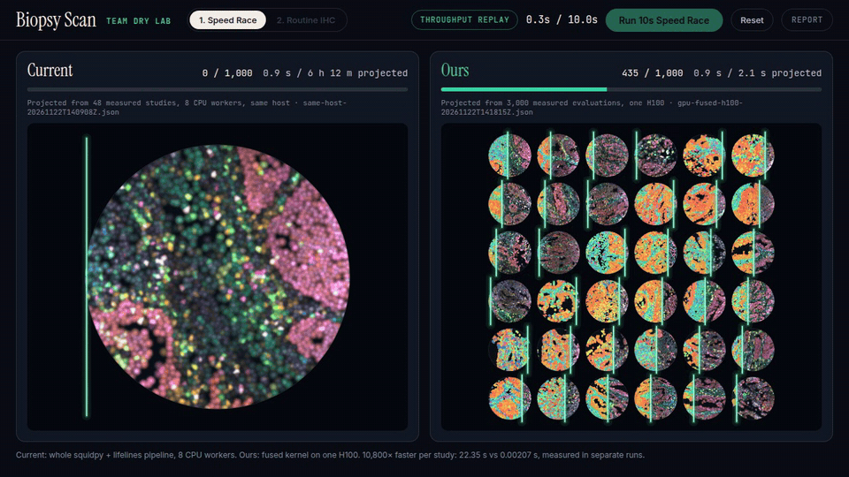
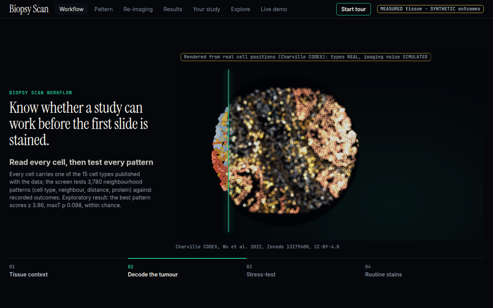

# Biopsy Scan

**Know whether your spatial-biology study can work before you image a single slide.**

[](LICENSE)
[](https://github.com/atiladeokegab/biopsy-scan/actions/workflows/smoke.yml)

[](https://atiladeokegab.github.io/biopsy-scan/)

Biopsy Scan simulates thousands of spatial-biomarker studies cell by cell on real CODEX tumour tissue.
Give it a study design (patients, regions per patient, field of view, cell mis-call rate) and it tells
you how likely the study is to find a survival-linked cell pattern, with multiple-testing correction
across every candidate pattern.



<sub>The race replays two separately measured rates: off-the-shelf squidpy + lifelines on 8 CPU workers vs
Biopsy Scan's fused kernel on one H100. Details in [RESULTS.md](RESULTS.md#demo-race-replay).</sub>

## Why it matters

Textbook power formulas assume every cell pattern is measured exactly on the whole tissue. In one
modelled scenario on the Charville colorectal cohort, they are far too optimistic:

| 200 simulated patients, HR 2.0 per SD, 630 candidate patterns, Bonferroni at α = 0.05 | Study power |
|---|---|
| Schoenfeld formula (**ANALYTIC**) | 80.1% |
| Biopsy Scan, simulated on real tissue, 300 studies (**ESTIMATE**) | **27.0%** (95% CI 22.1–32.4%) |

The gap depends on the design (the formula overstated power at 6 of 7 patient counts tested).

Simulating thousands of studies per design needs speed. Each pipeline below runs one simulated study
(re-image every patient, score every candidate pattern) on 8 CPU workers:

| Pipeline | Seconds per study | Biopsy Scan's fused kernel is |
|---|---|---|
| **Industry standard:** off-the-shelf squidpy + lifelines | 22.35 s | **534× faster** per study (same host with 8 CPU workers per side; **MEASURED**; the timing windows differ) |
| **Best current method, reimplemented and optimised:** neighbour recount and a permutation test per study | 0.881 s | **21× faster** per evaluated study (8 workers each; **MEASURED**, cross-run) |
| **Biopsy Scan**, fused kernel | 0.0426 s (same host), 0.0419 s (cross-run) | |

Speed doesn't cost accuracy. Every re-imaging kernel is tested against a float64 reference implementation
(bit-equal features, or within a stated tolerance), and on a matched configuration Biopsy Scan's top
pattern agrees with squidpy + lifelines in 16 of 16 studies ([details](docs/external-agreement.md)).

Every number, with its evidence label, source file and caveats: **[RESULTS.md](RESULTS.md)**.

| Start from real tissue | Race the off-the-shelf tools | Take it to routine IHC |
|---|---|---|
|  |  |  |

## Installation

You need `git`, `make`, [`uv`](https://docs.astral.sh/uv/), `python3` (3.9+) and Node.js. uv
installs the pinned Python 3.11.

```sh
git clone https://github.com/atiladeokegab/biopsy-scan.git
cd biopsy-scan
make smoke   # install, offline tests and demo checks (about 7 minutes, no data or GPU)
make demo    # serve the demo at http://localhost:8000
make data    # optional: download the public CODEX cohorts (about 730 MB)
```

## Documentation

Guides, architecture (C4 diagrams), methods, pre-registration and results:
**[atiladeokegab.github.io/biopsy-scan](https://atiladeokegab.github.io/biopsy-scan/)**.

## Contact

- Questions: [Discussions](https://github.com/atiladeokegab/biopsy-scan/discussions)
- Bugs and feature requests: [issues](https://github.com/atiladeokegab/biopsy-scan/issues)
- Security: report privately, see [SECURITY.md](SECURITY.md)
- Authors: Atilade Oke ([GitHub](https://github.com/atiladeokegab), [LinkedIn](https://www.linkedin.com/in/atiladeoke/)) and Faisal Lawan ([GitHub](https://github.com/FHL-08), [LinkedIn](https://www.linkedin.com/in/faisal-lawan/))

## Contributing

See [CONTRIBUTING.md](CONTRIBUTING.md) and the [Code of Conduct](CODE_OF_CONDUCT.md).

## Citation

```bibtex
@software{preflight_2026,
  author  = {{Team Dry Lab}},
  title   = {Biopsy Scan: Cell-by-Cell Spatial-Biomarker Study Simulation and Clinical IHC Translation},
  year    = {2026},
  url     = {https://github.com/atiladeokegab/biopsy-scan},
  license = {MIT}
}
```

If you use the cohorts or the biomarker definitions, please also cite Wu et al., *Nature Biomedical
Engineering* (2022) and Punovuori et al., *Cell* 187:7267 (2024). The biology of the pre-registered
rule comes from Punovuori et al.

## License

The code is [MIT](LICENSE) © 2026 Team Dry Lab. The data keep their own licences: the cohorts come from
Wu et al., *Nature Biomedical Engineering* (2022), Zenodo
[13179600](https://zenodo.org/records/13179600), CC BY 4.0, and some derived cell-level extracts
are committed under the same licence. The IHC photos are from the
[Human Protein Atlas](https://v25.proteinatlas.org/) v25, CC BY 4.0 (Uhlén et al., *Science* 2015),
cropped and resized; sources in [`hpa_manifest.json`](demo/workflow/img/hpa_manifest.json). Details:
[docs/data.md](docs/data.md).
