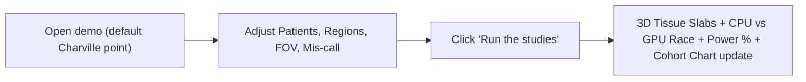

# Preflight Design System & Demo Spec

Owner: Hephaestus (design), implemented in `demo/` by Zeus (`#7`).
Binding token file: `demo/tokens.css`. Only `docs/design.md` and `demo/tokens.css` hold system tokens and visual specification; `demo/` components must reference `var(--...)` from `demo/tokens.css` with zero inline hexes or off-scale sizes.

---

## 1. Intent & One Job

- **Product:** Preflight — Rehearse a spatial-biology study before imaging a single slide.
- **Audience:** Spatial-biology study leads and hackathon judges watching a 3-minute demonstration.
- **One job of the page:** Let a user dial study design parameters (`Patients`, `Regions per patient`, `Field of view`, `Mis-call rate`), see how region count, crop size, and cell-type mis-calls affect observed tissue, compare CPU-vs-GPU runtime, and answer whether the study can find the pattern for the fixed planted-effect scenario in `grid.json` as `Power %` and `Identification %` on their cohort's atlas (conditional on that planted scenario, never a universal adequacy guarantee).
- **Brand posture:** Precision scientific instrument on a deep slate ground (`#0B1018`). Calm, legible typography in `Inter`, domain-authentic tissue colors (`#FF7A59` tumour, `#F5C451` immune, `#56687A` stroma), and **no dot mark** next to the `Preflight` wordmark.

---

## 2. First Principles: What a Judge Must See in 3 Minutes

| Window | Visual Proof | What the Judge Sees |
|---|---|---|
| 0:00–0:25 | First fold (`1280×633` & `390×757`) | Page title (the tagline), 1-line subtitle, dominant **3D Tissue Slabs** canvas, interactive design sliders, primary button, and immediate **Power %** + **Identification %** answer. |
| 0:25–1:45 | Tissue distortion & CPU-vs-GPU race | Dragging `Regions per patient` draws up to `k` regions per patient without replacement (capped at each patient's available regions) and places one `Field of view` square crop per sampled region (FOV capped at the cohort's region size — Charville ~650 µm, UPMC ~1000 µm — plus full core), dimming excluded cells outside the crop; raising `Mis-call rate` recolors cells across tumour/immune/stroma. Clicking **"Run the studies"** compares **CPU (all cores, Numba) vs. GPU (batched studies)** (both sharing identical per-region `region_kernel` sampling; neutral measured timing with `UNMEASURED` placeholder when `bench` has not run, distinct from the illustrative tile reveal), lighting found (`#2BD4A4`) vs missed (`#243040`) tiles. |
| 1:45–3:00 | Design Atlas curve | **One chart**: `Power against patients`, plotting one curve per `Regions per patient` setting present in the saved `grid.json` at the active `Field of view`, `Mis-call rate`, and fixed planted-effect scenario, with `"our cohort"` (Charville, `P = 159`, `38` events) marked in `#2BD4A4`. |

### Hierarchy, Motion, and What Is Cut

- **Hierarchy:** (1) 3D Tissue Slabs hero canvas -> (2) Design sliders + primary CTA + Power `%` answer -> (3) CPU-vs-GPU tile race -> (4) Power-vs-patients chart.
- **Motion (only 3 purposeful behaviors):**
  1. Slow, continuous 3D slab rotation on the tissue canvas (`prefers-reduced-motion: reduce` disables auto-rotation; keyboard arrow keys + pointer drag + `Pause rotation` button remain active).
  2. Left-to-right study-tile reveal during the CPU-vs-GPU race on button click.
  3. **3D section motion** (`#reimage`, "A study sees two fields of view and mis-calls some cells"): one 15 s fly-through, played once when 35% of the canvas is on screen. The clock pauses while the canvas is off screen. Camera moves ease in-out cubic, with distance interpolated in log space: whole region (0–0.8 s), zoom to cell level (0.8–4.6 s), hold (4.6–6.2 s), pull back (6.2–9.0 s), fields of view light up (9.0–10.4 s), the rest dims (10.0–10.8 s), settle on the fields (10.6–12.2 s), then mis-calls flicker on 0.4 s beats, under 3 flashes a second (12.2–14.6 s), and keep the wrong colour, ringed. The step captions follow at 0, 4.6, 8.4 and 11.2 s. The take ends still at 15 s, with only `Replay the fly-through` offered; `Pause the fly-through` shows while it plays. `prefers-reduced-motion: reduce` draws the last frame still, shows every step and hides both controls.
  Zero decorative fade-in/slide-up reveals, zero hover card lifts, zero pulsing status dots.
- **Explicitly cut:**
  - **No dot mark** beside the `Preflight` wordmark.
  - **No tracked ALL-CAPS eyebrow chips/kickers** above headings.
  - **No secondary charts, multi-card SaaS marketing grids, gradients, glassmorphism, glow borders, or nested cards.**
  - **No clinical efficacy claims** or unmeasured speedup multipliers (`UNMEASURED` and `SYNTHETIC` tags render plainly until `bench/` and `atlas/` produce measured JSONs).

---

## 3. Flow & Screen Structure

| Section | Shows | User Can |
|---|---|---|
| Top bar (`48px`) | Plain text wordmark `Preflight` (left), `Team Dry Lab` + data provenance tag (`SYNTHETIC` / `MEASURED`) (right) | Inspect provenance cleanly |
| Hero & Stage (First Fold) | Page `h1` (the tagline), 1-line subtitle, dominant 3D tissue canvas (`#tissue`), legend (`Tumour`, `Stroma`, `Immune`, `Field of view`), design controls (`Patients`, `Regions per patient`, `Field of view`, `Mis-call rate`), primary CTA (`Run the studies`), answer (`Power %` + `Identification %`) | Drag/rotate 3D slabs, pause spin, tune 4 sliders, trigger replay |
| 3D re-imaging (`#reimage`) | One real Charville region in 3D (MEASURED cells), two simulated 400 µm fields of view and the cells mis-called into another colour group (SYNTHETIC), four numbered steps, legend, source credit; a GPU still and a recovery line when WebGL is off | Watch the fly-through once, pause it, replay it |
| Study Race | Side-by-side 2D study-tile grids: `CPU (all cores, Numba)` vs `GPU (batched studies)`, tile counts, neutral measured seconds (or `UNMEASURED` placeholder) | Compare fair all-core CPU vs batched GPU runtime |
| Design Atlas Chart | Single SVG chart: `Power vs. Patients` (curves for the `Regions per patient` settings saved in `grid.json`), vertical/dot markers for current design, planted scenario caption, and `"our cohort"` | See whether adding regions beats adding patients |

---

## 4. Tokens (`demo/tokens.css`)

### Color Roles & Strict One-Accent Rule

| Token | Hex | Role & Strict Constraint |
|---|---|---|
| `--bg` | `#0B1018` | Page background |
| `--bg-canvas` | `#070B11` | Deep canvas well behind 3D tissue & race tiles |
| `--surface` | `#121A25` | Control rail / race lane / chart panel fill |
| `--surface-elevated` | `#182230` | Hover / active control surface |
| `--border` | `#22303F` | 1px structural divider & border |
| `--text-head` | `#F4F7FA` | Headings, active metric values, keyboard focus ring (`>= 15:1` on `--bg`) |
| `--text-body` | `#B9C6D4` | Body text, control labels (`>= 9.8:1` on `--bg`) |
| `--text-muted` | `#8898AA` | Axis ticks, legend secondary text (`>= 5.6:1` on `--surface`) |
| `--accent` | `#2BD4A4` | **ONLY** spent on primary CTA button (`Run the studies`), `found` study tiles, and `"our cohort"` mark on the chart |
| `--accent-ink` | `#071310` | Button label ink on `--accent` (`>= 10:1` contrast) |
| `--tumour` | `#FF7A59` | Tumour focal cells (`3D tissue` & legend) + error border |
| `--immune` | `#F5C451` | Immune cells (`3D tissue` & legend) + `SYNTHETIC`/`UNMEASURED` notice border |
| `--stroma` | `#56687A` | Background stroma cells (muted slate so `--accent` stays unambiguous) |
| `--tile-miss` | `#243040` | Missed study tile fill in CPU/GPU race |

### Type Scale (`Inter`, 6 steps, `>= 12px` everywhere)

| Token | Size | Line Height | Usage |
|---|---|---|---|
| `--text-2xl` | `48px` (`3rem`) | `1.08` (`--leading-tight`) | Desktop `h1` and headline Power `%` (`font-variant-numeric: tabular-nums`) |
| `--text-xl` | `32px` (`2rem`) | `1.12` (`--leading-display-sm`) | Phone `h1`, Power `%` (390) |
| `--text-lg` | `20px` (`1.25rem`) | `1.25` (`--leading-snug`) | Section titles, tagline |
| `--text-base` | `16px` (`1rem`) | `1.5` (`--leading-normal`) | Body text, slider labels, primary CTA label |
| `--text-sm` | `14px` (`0.875rem`) | `1.45` (`--leading-meta`) | Sub-metrics, identification sentence, race captions |
| `--text-xs` | `12px` (`0.75rem`) | `1.4` (`--leading-caption`) | Chart ticks, legend tags, provenance badge (floor: never `< 12px`) |

### Spacing Scale (8 steps) & Radii (2 steps)

- Spacing (`4px` base): `--space-1` (`4px`), `--space-2` (`8px`), `--space-3` (`12px`), `--space-4` (`16px`), `--space-5` (`20px`), `--space-6` (`24px`), `--space-7` (`32px`), `--space-8` (`48px`).
- Radii: `--radius-control` (`6px` for buttons, badges, legend keys), `--radius-surface` (`10px` for canvas frames, control panel, race lanes, chart card).
- Layout Grid:
  - **Desktop (`1280×633`)**: `max-width: var(--container-max)` (`1232px`), `24px` outer margin, `20px` gutter, first-fold stage sized so header + title + 3D tissue (`--tissue-height-desktop: 314px`) + CTA + Power `%` stay visible inside `633px`.
  - **Phone (`390×757`)**: single column (`16px` outer margin, `12px` gap); redrawn compact 3D tissue view (`--tissue-height-mobile: 220px`) + primary CTA (`>= var(--target-min)` `44px`) + Power `%` sit inside the first `757px` with zero horizontal scroll (`0px` overflow) and zero text `< 12px`.

---

## 5. States & Copy

| Where | Normal | Empty / Unmeasured | Loading | Error (with user recovery) |
|---|---|---|---|---|
| 3D Tissue (`#tissue`) | Renders distinct patient samples, `k` sampled regions without replacement (capped per patient), one FOV crop per region, mis-call recolor | `"No cells loaded for this design."` | `"Preparing tissue slabs..."` | `"Cannot load tissue data. Serve over HTTP (python3 -m http.server 8000 -d demo) and reload."` |
| CPU-vs-GPU Race | Lights `1,000` tiles; shows measured `CPU s -> GPU s` | `UNMEASURED`: shows tile simulation with `"Measured CPU/GPU timing pending bench run."` | Animates tiles left-to-right | `"Bench timing unavailable; grid power estimates still active."` |
| Answer & Chart | Tabular-numeral Power `%` + Identification `%` + cohort curve | `"Select a design point to view power."` | `"Evaluating design..."` | `"Cannot read grid.json. Run python3 -I demo/check_data.py and reload."` |

### Frozen Copy Glossary

| Concept | Exact Term Used Everywhere |
|---|---|
| Product mark | `Preflight` (wordmark only, no dot mark) |
| Primary CTA | `Run the studies` |
| Axis 1 / 2 / 3 / 4 | `Patients`, `Regions per patient`, `Field of view`, `Mis-call rate` |
| Cell classes | `Tumour`, `Stroma`, `Immune` |
| Outcome metrics | `Power` (`share of all studies at the active design & fixed planted scenario where maxT rejects at the unconditional threshold`), `Identification rate` (`share of all studies where the top-ranked feature matches the planted motif`, stating `"of all studies"` explicitly as denominator) |
| Provenance tags | `SYNTHETIC` / `MEASURED` / `UNMEASURED` (never omit; never overclaim) |
| Cohort marker | `Our cohort` (Charville: `159 patients · 38 events`, `explored already-seen`) |
